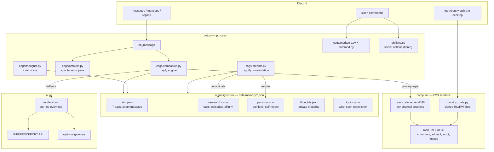

# Architecture

Inferolli is a Discord bot that behaves like a member rather than a command
interface: it remembers, forms opinions, watches conversations, and has a real
desktop it can operate. This document explains how the pieces fit and where
state lives.

## The reply path

A message that mentions the bot goes through, in order:

1. **Screen errand** (`_desktop_errand`) — if the message is a screen request
   ("open X", "search Y"), the bot does it directly, deterministically, and
   sends the screenshot before any model is involved. Model mood cannot break
   this path.
2. **Memory assembly** — the person's file, server lore, thoughts formed in
   *this* room, relevance-gated cross-channel recall, and the room-topic map.
3. **Primary engine** — the persistent `opencode` session for that channel,
   which has bash/files tools and remembers its own thread.
4. **Fallback** — an inline tool loop (`tools_server.py`) with web search,
   channel history, member profiles, docs search, and — for admins — the
   computer.
5. **Delivery** — anything dropped in `/workspace/outbox/` during the reply is
   attached; failures produce a graceful line instead of silence.

## Memory model

| Store | Holds | Lifetime |
|---|---|---|
| `stm.json` | every message seen, with optional embeddings | 7 days, 2500 entries |
| `users/<id>.json` | facts, episodes, affinity, names | until decay |
| `persona.json` | opinions with history, running jokes, self-model | permanent |
| `thoughts.json` | private observations, who they're about | 7 days |
| `topics.json` | one line per channel: what that room is for | 14 days since last update |

Retrieval is **salience × recency × relevance**, and relevance has a floor: if
nothing on file actually relates to the current conversation, recall returns
nothing rather than padding a list. Confidence in a reply should never come
from volume.

## Trust boundaries

| Tier | Who | May |
|---|---|---|
| member | everyone | chat, music, watch the desktop |
| staff | moderators | warn/mute/kick/ban, purge, pin, **touch** the desktop |
| admin | administrators | channel and role structure, shell on the computer |

Tiers come from `config.json` (`permissions`), so what a role may do is a
config decision rather than a hardcoded check. Every action declares its
minimum tier; anything unlisted defaults to admin.

## Persistence and failure

The bot lives in one E2B sandbox (`scripts/e2b_launch.py`). Because E2B pauses
sandboxes at 24 hours, `scripts/shepherd.py` watches it, backs the cortex up to
S3 before migrations, and relaunches when needed. `cogs/backup.py` also
snapshots nightly after the dream.

Nothing critical depends on the VPS being awake: the sandbox holds the process,
and the cortex is rebuilt from S3.

## Configuration

- `config.json` — non-secret: models, job routing, timings, permission tiers.
  This is the file to edit for normal changes.
- `.env` — secrets only: Discord token, API keys, backup credentials.

`config.json` wins over the environment, then the built-in default applies.
The environment is a fallback for values config.json doesn't define (and the
home of secrets). Overriding a configured value for one run means pointing
`BOT_CONFIG_FILE` at another file — a stale env var should never silently win.
